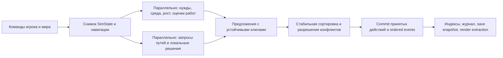

# Архитектура и план: многопоточная колониальная симуляция

**Дата исследования:** 10 октября 2026 г.  
**Статус:** техническая рекомендация и план вертикального среза  
**Рабочее название:** `ParallelColonySim`

## Короткое решение

Для нового самостоятельного проекта рекомендую **Bevy 0.20 + Rust**. Это не мод и не переписывание закрытого кода RimWorld, а отдельная 2D-игра в жанре симулятора колонии со своей логикой, названием, текстами и графикой. Если задача на самом деле — мод для установленного RimWorld, то моддинг и замена его внутреннего планировщика потоков являются разными проектами: обычный мод не может безопасно распараллелить произвольный код исходной игры.

Bevy лучше подходит именно для первого проекта, который будет в основном реализовывать Codex: симуляционное ядро можно держать в обычных Rust-модулях и проверять без окна игры, а ECS-планировщик запускает совместимые системы параллельно. Unity DOTS тоже предоставляет зрелые Jobs/Burst/ECS и сильный визуальный редактор; его выбрал бы при наличии команды Unity-разработчиков, готового контентного пайплайна или большой зависимости от редактора. Решение в пользу Bevy — инженерная оценка под эту задачу, а не утверждение, что Bevy всегда быстрее Unity.

На дату документа выпущен Bevy 0.20 (8 октября 2026 г.), но часть Quick Start страниц всё ещё показывает 0.19. Поэтому версию следует явно закрепить, брать примеры именно из релиза 0.20 и перед основным кодом собрать небольшой технический срез. Bevy 0.20 release notes: [bevy.org/news/bevy-0-20](https://bevy.org/news/bevy-0-20/); переходы API: [руководство 0.19 → 0.20](https://bevy.org/learn/migration-guides/0-19-to-0-20/).

## Сравнение движков

| Критерий | Bevy 0.20 | Unity 6.3 LTS + Entities/DOTS |
|---|---|---|
| Параллелизм | ECS scheduler запускает системы, не конфликтующие по доступу к данным; можно группировать системы и задавать зависимости. Внутри крупных однотипных вычислений — параллельные задачи и независимые буферы результатов. | Unity Job System распределяет задания по worker threads; Entities/DOTS добавляет data-oriented ECS, Burst компилирует поддерживаемые задачи в нативный код. |
| Проверяемость симуляции | Обычный Rust-код удобно запускать в headless-режиме, воспроизводить seed и сравнивать сериализованные состояния. | Тоже можно запускать без рендера, но проект сильнее связан с Unity Editor и версиями пакетов. |
| Инструменты | Rust/Cargo, VS Code и `rust-analyzer`; редактор сцен не является центральной частью Bevy. | Сильный редактор и инструменты авторинга, но нужна установка Unity Editor и конфигурация DOTS-пакетов. |
| Риски | Rust требует освоения; Bevy развивается быстро, а релиз 0.20 совсем новый. API фиксировать `Cargo.lock`, не смешивать документацию разных выпусков. | DOTS требует дисциплины ECS/Jobs/Burst и правильной работы с NativeContainers и job dependencies; большое число частей в одном проекте усложняет настройку Codex. |
| Подходит, если | Главный риск — производительность и корректность симуляции, проект кодируется преимущественно Codex, нужен небольшой headless benchmark. | Уже есть Unity-команда/контент, важны редакторные инструменты, asset pipeline или переиспользование существующего Unity-кода. |

Bevy документирует параллельное исполнение систем с учётом конфликтов доступа в [ECS schedule](https://docs.rs/bevy_ecs/latest/bevy_ecs/schedule/struct.MultiThreadedExecutor.html). Unity описывает worker threads, work stealing и проверку гонок в [Job System overview](https://docs.unity3d.com/6000.3/Documentation/Manual/job-system-overview.html); актуальная документация пакета [Entities 1.4.8](https://docs.unity3d.com/Packages/com.unity.entities@1.4/manual/index.html) называет его data-oriented ECS частью DOTS.

## Цели и границы первой версии

### В цели входят

- 2D-карта на сетке с землёй, стенами, зонами, температурами и ресурсами.
- Поселенцы с потребностями, навыками, назначениями, инвентарём и состояниями работ.
- Приоритетная система работ: поиск, резервирование цели/ресурса, путь, выполнение, отмена и повтор.
- Растения, простая погода, строительство, перенос предметов и простой бой как отдельные подсистемы.
- Фиксированные игровые тики, одинаковые сохранения/повторы для одинакового seed и команд.
- Рендер и UI, которые только отображают симуляцию и передают команды; они не являются источником игрового состояния.

### Не входят в первую версию

- Переписывание или модификация закрытых исходников RimWorld.
- Полное совпадение контента, баланса и интерфейса оригинальной игры.
- Мультиплеер, моддинг-API и произвольные скрипты до устойчивой модели сохранения.
- Ручное создание потоков на каждого жителя. Используем планировщик/пул задач, а не один поток на сущность.

## Слои программы

1. **`game_app`** — запуск Bevy, настройки окна и режимов, ввод, меню, связывание плагинов.
2. **`sim_core`** — авторитетное headless-состояние, номер тика, команды, события, сохранение и детерминированный RNG.
3. **`sim_world`** — сетка карты, чанки, температура, растения, проходимость и индексы карты.
4. **`sim_agents`** — компоненты жителей, нужды, навыки, режимы поведения и оценка работ.
5. **`sim_jobs`** — описания работ, приоритеты, резервации предметов/целей, переходы состояния работ.
6. **`sim_navigation`** — снимок стоимости перемещения, поиск путей и кэширование маршрутов.
7. **`sim_combat`** — выбор цели, попадания, урон, лечение и события боя.
8. **`content`** — собственные определения предметов, зданий, растений и рецептов в версионируемых данных.
9. **`savegame`** — версионированная сериализация `SimState`, миграции сохранений и replay-команды.
10. **`ui`** — выбор объектов, панели, приказы и визуальные подсказки; чтение через снимки/экспорт для рендера.
11. **`sim_testkit` и `benches`** — генератор сценариев, повтор команд и бенчмарки одинаковых seed.

Держать это логическими модулями в начале разработки; превращать каждый пункт в отдельный crate только когда границы и зависимости стабилизируются.

## Авторитетные данные

### Карта

Разбить карту на чанки (например, 32×32 или 64×64 клетки — выбрать бенчмарком). Частые числовые поля хранить в плотных массивах по ячейкам: тип поверхности, препятствия, стоимость перемещения, температура, влажность, рост растений. Это снижает случайные обходы множества ECS-сущностей. Между соседними чанками читать из неизменяемого снимка; запись делать в новый буфер и менять активный буфер на барьере тика.

### Существа и работы

Жители, предметы, здания и работы — ECS-сущности с компонентами. Сохранения и события не должны использовать только временный `Entity`: назначить стабильный `SimId`, который переживает загрузку мира. Большие списки работы обслуживать индексами/очередями по типу и зоне, а не сканированием всех работ на каждого жителя.

Возможные компоненты жителя: `SimId`, `GridPosition`, `Needs`, `Skills`, `WorkPriorities`, `CurrentJob`, `Inventory`, `Health`, `Faction`. Возможные состояния работы: `Available → Reserved → Traveling → Performing → Completed/Failed/Cancelled`. Резервация предмета и клетки должна быть единым атомарным решением в детерминированной фазе назначения.

### Сохранение

Хранить версию схемы, seed, номер тика, стабильные ID, состояние мира и последовательность ещё не обработанных команд. Проверять загрузку старых версий миграциями. После загрузки перестраивать производные кэши (например, индекс ближайших работ), не считать их источником истины.

## Поток одного игрового тика



**Контракт фаз:** параллельный расчёт читает неизменяемый снимок и выдаёт предложения/локальные буферы. Фаза arbitration сортирует результат по ключу `(phase, chunk_id, stable_sim_id, local_sequence)` и решает, кто получил общую цель/предмет. Commit применяет уже разрешённые изменения. Это предотвращает ситуацию, когда победителя гонки выбирает планировщик потоков.

Планировщик Bevy может распараллелить системы только тогда, когда их доступы и зависимости это позволяют; глобальная изменяемая `Resource` или `Query<EntityMut>` может свести полезный параллелизм к последовательному. Разделять чтение, предложения и запись следует по реальному графу данных и после измерения.

## Детерминизм и многопоточность

- Время симуляции — целое `SimTick`; скорость игры определяет, сколько тиков запускается за секунду реального времени, а не меняет математику одного тика.
- Для случайных событий брать независимый поток из `(world_seed, tick, subsystem_id, SimId/chunk_id)`. Не использовать общий изменяемый RNG из параллельных систем.
- Все конфликтующие события и редукции собирать отдельно и сливать стабильным порядком. Для суммирования использовать фиксированный порядок, если важна повторяемость.
- Не разрешать параллельным системам напрямую присваивать один `CurrentJob`, менять общий склад или писать в одну клетку. Они формируют `JobBid`, `InventoryClaim` и `CellDelta`; единый resolver принимает непересекающиеся изменения.
- Для соседних вычислений на сетке использовать двойную буферизацию: текущий tick читает `current`, результат собирается в `next`, после барьера буферы меняются.
- Если нужно гарантировать одинаковый результат на разных процессорах/ОС, не полагаться на неассоциативную арифметику `f32` в авторитетных редукциях: выбрать целые/фиксированную точку или каноническое округление.
- Не распараллеливать последовательность игровых тиков: тик N+1 зависит от результата N. Распараллеливать работу внутри одного тика и подсистемы с независимыми данными.

## Игровая логика работ

1. Система work-giver выдаёт кандидатов: например, голодный житель получает приоритет приготовления/еды, а склад — кандидатов на перенос.
2. Рабочий скорер для каждого жителя параллельно рассчитывает ограниченный набор `(job, target, utility, estimated_cost)` из одного снимка.
3. Назначение сортирует кандидатов детерминированно: приоритет игрока, utility, штраф пути, затем стабильный ID.
4. Resolver атомарно резервирует цель/ресурс и назначает `CurrentJob` тем, кто выиграл; проигравшие идут к следующему кандидату.
5. Житель проходит маленькую машину состояний работы: проверить путь → двигаться по маршруту → проверить предусловия → выполнить один шаг → записать событие → завершить или запросить новую работу.
6. Путь строится по версии nav snapshot. Если карта изменилась и версия устарела, путь пересчитывается; нельзя бесконечно двигаться по устаревшему маршруту.

## Что распараллеливать сначала

1. Чтение нужд и вычисление новых значений по жителям.
2. Рост растений/изменение температуры по независимым чанкам карты.
3. Оценку работ и расчёт спроса на маршруты по жителям.
4. Поиск маршрутов по неизменяемой стоимости клеток.
5. Урон/эффекты по независимым парам/группам, затем стабильное разрешение конфликтов.

Системы инвентаря, складов, строительства и работы с общими клетками сначала оставить в фазе арбитража. Распараллелить их позднее только при доказанной нагрузке и наличии корректной схемы владения данными.

## Этапы реализации

### 0. Уточнить продукт и построить базовую нагрузку

Зафиксировать оригинальное название/контент, платформу, размер карты и число жителей. Сделать генератор repeatable-сценария: seed + список жителей/предметов/работ + команды. Измерить простой последовательный эталон времени тика и построить профиль до оптимизации.

### 1. Технический вертикальный срез

Закрепить Bevy/Rust версии в Cargo workspace и `Cargo.lock`. Запустить пустое окно, но главное — запустить `sim_core` без рендера. Реализовать `SimTick`, стабильный ID, seed-based RNG, снимок состояния и журнал команд. Проверить, что одинаковые seed/команды дают одинаковое состояние.

### 2. Минимальный цикл выживания

Создать небольшую сетку, несколько жителей, одну потребность, один склад, простую еду и работу «добыть/принести/съесть». Сделать резервирование, путь, отмену, смерть/потерю цели и сохранение/загрузку.

### 3. Параллельный срез

Для нужд, ростка растений и utility scoring добавить параллельные системы/чанки. На том же сценарии сравнить результаты 1/2/4 worker threads. Конфликтующие результаты вести через proposal buffers и стабильный resolver; сравнить hash мира после фиксированного числа тиков.

### 4. Базовые колониальные системы

Добавить добычу, строительство, изготовление, перенос, сон, пищу, настроение/простое социальное взаимодействие, опасность и животных. Сохранить отдельные границы между подсистемами и версионировать content data.

### 5. Бой, события и устойчивость сохранений

Добавить рейды/бой, погоду, пожары/опасности и обработку отменённых задач. Проверить повтор/replay при разных скоростях игры, сохранение посреди выполнения работы и миграцию сохранений после изменения схемы.

### 6. UI, визуализация и авторинг контента

Сделать карту, слои отображения, панели жителей/работ, приказы, зоны, фильтры и редактор стартовых сценариев. UI отправляет команды с целевым тиком; он не меняет компоненты симуляции напрямую.

### 7. Профилирование и выпуск

Собирать отдельно время стадий, процент доступного параллельного времени, длину критического пути, ожидание барьеров, число запросов пути, долю отмен и размер памяти. Сравнивать Release build на повторяемых сценариях; оптимизировать только горячие стадии. Проверить деградацию на 1–2 ядрах и рост на 4 ядрах, затем — на более широких CPU.

## Проверки производительности и корректности

Начальный набор нагрузок: карты 64×64 и 256×256; 10, 50, 200 и 500 жителей; одинаковое расписание работ и seed. Значения — стартовые тестовые ступени, их следует менять после первого профиля. На машине, обнаруженной сейчас, 4 физических ядра: для первого реального измерения достаточно сравнить 1/2/4 worker threads; это не доказывает масштабирование на 8–16 ядер.

Для каждой ступени сохранять: среднее/95-й перцентиль времени simulation tick, время отдельных стадий, загрузку worker threads, ожидание sync point, память, завершённые тики/секунду и hash состояния. Критерии готовности: один и тот же replay даёт один и тот же результат на всех поддерживаемых режимах worker count; сохранение/загрузка внутри активного мира не меняет дальнейший replay; параллельный режим не теряет и не дублирует резервации. Целевые миллисекунды устанавливать после базового профиля, а не угадывать заранее.

## Стартовая структура репозитория

```text
parallel-colony-sim/
├── Cargo.toml                 # workspace и закреплённые зависимости
├── Cargo.lock
├── crates/
│   ├── sim-core/               # SimState, tick, events, stable IDs, RNG
│   ├── sim-world/              # чанки, tile buffers, окружение
│   ├── sim-agents/             # pawn state, needs, AI scoring
│   ├── sim-jobs/               # work-givers, bids, reservations, job FSM
│   ├── sim-navigation/         # nav snapshots, маршруты и кэш
│   ├── sim-save/               # версии сохранений, миграции, replay
│   └── sim-testkit/            # deterministic scenarios и state hashes
├── apps/
│   └── game/                   # Bevy window, input, UI, render extraction
├── content/                    # игровые определения в собственном формате
├── benches/                    # повторяемые сценарии производительности
└── docs/                        # решения, диаграммы, протоколы измерений
```

В самом начале допустим один crate с таким делением на Rust modules; извлекать crates только после появления самостоятельных зависимостей.

## Инструменты

- **Установлено в этой сессии:** Rust stable через `rustup` (MSVC target), VS Code extension `rust-analyzer`; Git и VS Code уже были доступны.
- **Не установлено на момент подготовки:** MSVC C++ Build Tools, Windows SDK и CMake tools. Они нужны Bevy для Windows native dependencies; запущена установка ограниченного Visual Studio C++ workload. Она может ждать системного UAC-подтверждения, которое должен принять пользователь.
- Не ставить Unity Editor/DOTS, потому что это альтернативный движок и проект выбрал Bevy.
- Инструменты профилирования (`tracing`, `criterion`, Tracy/профайлер ОС) добавлять вместе с первым повторяемым benchmark, чтобы не плодить пакеты до появления измерений.
- Для открытой разработки CI, правила вклада, контроль лицензий и порядок работы с issue/PR вынесены в [план инструментов и открытого процесса](development-tooling.md); минимальный workflow уже проверяет формат, Clippy и сборку на Windows/Linux.

### Реализация Phase 0

В workspace создан headless `sim-core` на `bevy_ecs 0.20.0` и CLI `sim-profile`. Симуляция запускает ECS `MultiThreadedExecutor`; независимые системы нужд жителей и среды выполняются в одной фазе, решения о работах/навигации идут следующей фазой, после чего фиксируется номер тика. Профилировщик по умолчанию получает размер пула из `std::thread::available_parallelism()`; аргумент `--threads N` задаёт размер для воспроизводимого сравнения. Это не фиксирует архитектуру на текущих четырёх физических ядрах.

Исходные показатели, параметры и ограничения замеров находятся в [отчёте Phase 0](phase-0-baseline.md), исходные повторения — в CSV рядом с ним.

## Источники

- [Bevy 0.20 release](https://bevy.org/news/bevy-0-20/) и [migration guide 0.19 → 0.20](https://bevy.org/learn/migration-guides/0-19-to-0-20/).
- [Bevy ECS multi-threaded executor](https://docs.rs/bevy_ecs/latest/bevy_ecs/schedule/struct.MultiThreadedExecutor.html) и [ECS scheduling](https://docs.rs/bevy/latest/bevy/ecs/index.html).
- [Bevy Windows setup: Rust, MSVC, Windows SDK, CMake, rust-analyzer](https://bevy.org/learn/quick-start/getting-started/setup/).
- [Unity 6.3 LTS Job System](https://docs.unity3d.com/6000.3/Documentation/Manual/job-system-overview.html) и [Entities 1.4.8](https://docs.unity3d.com/Packages/com.unity.entities@1.4/manual/index.html).
